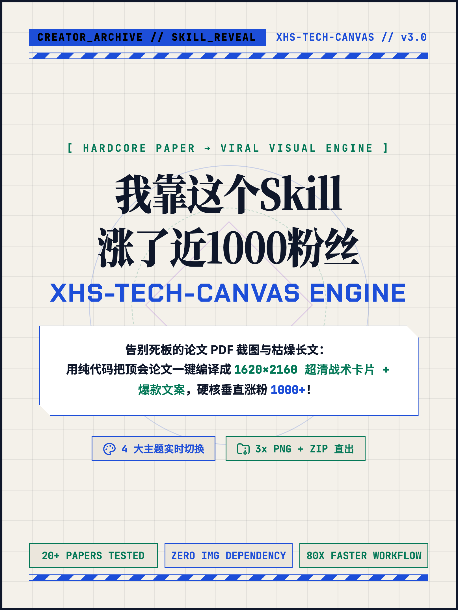
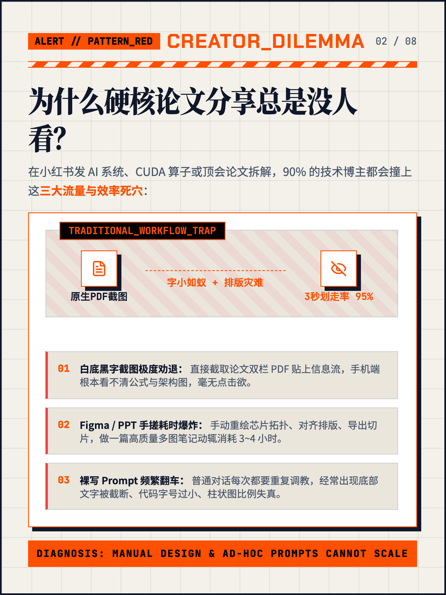
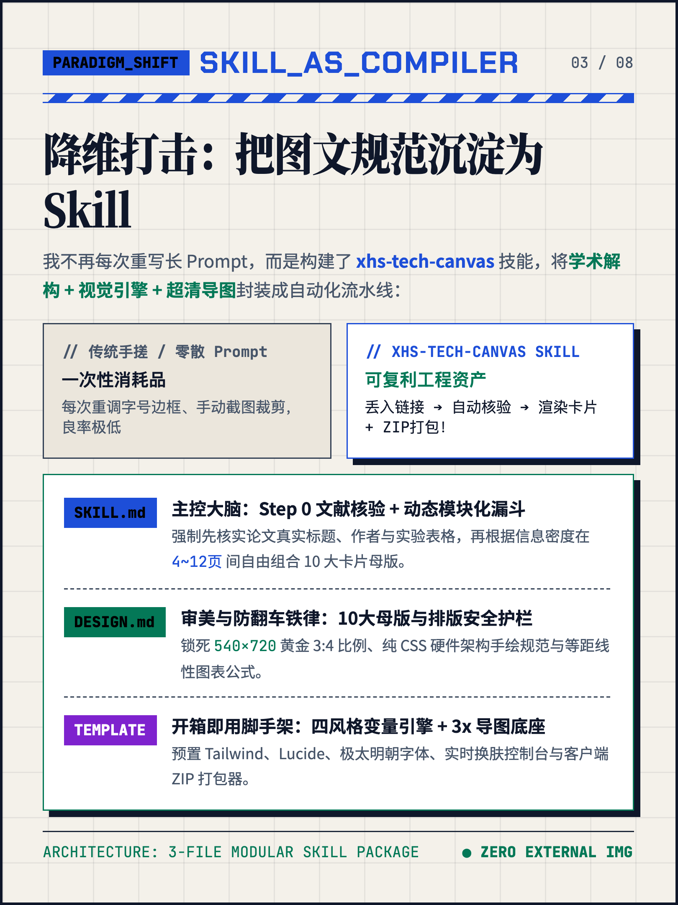
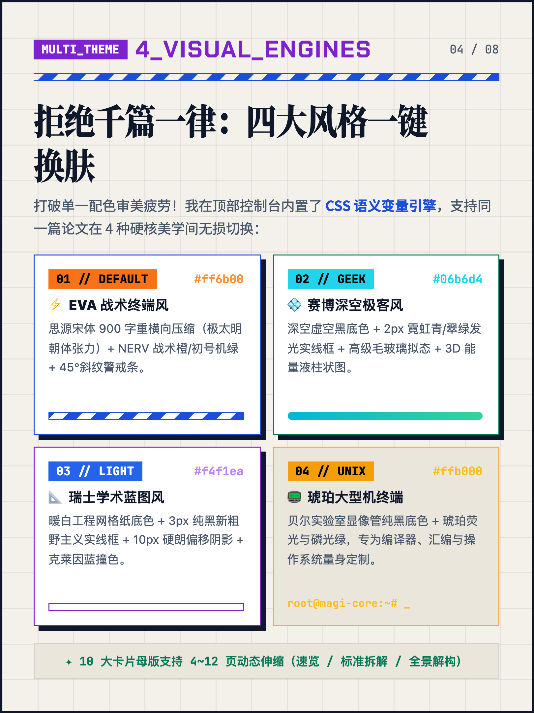
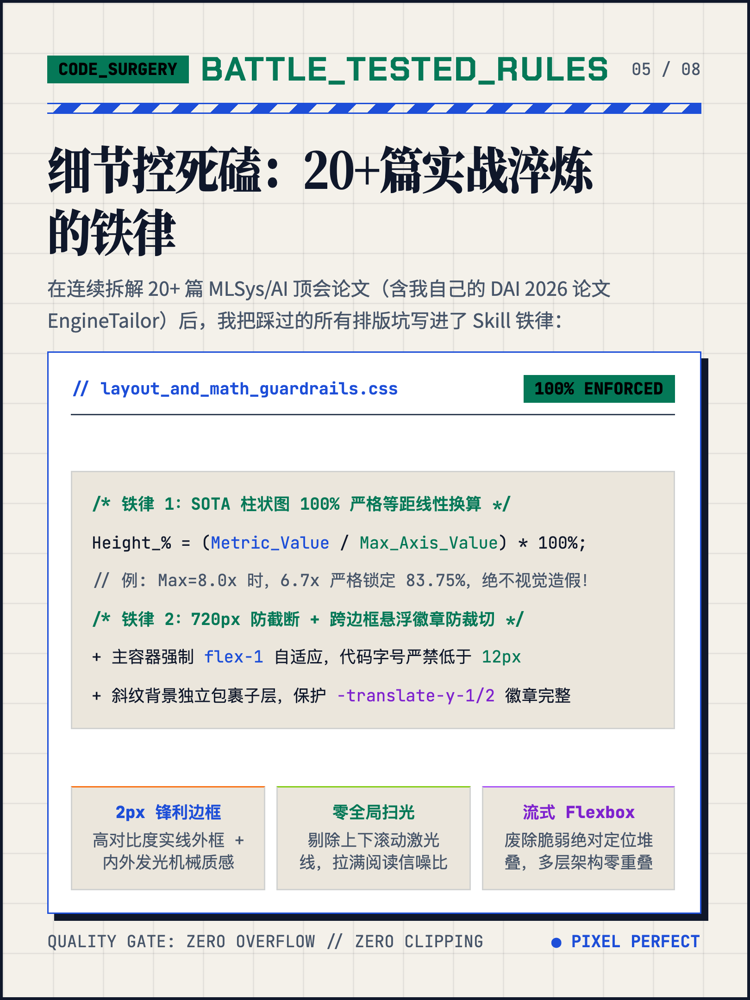
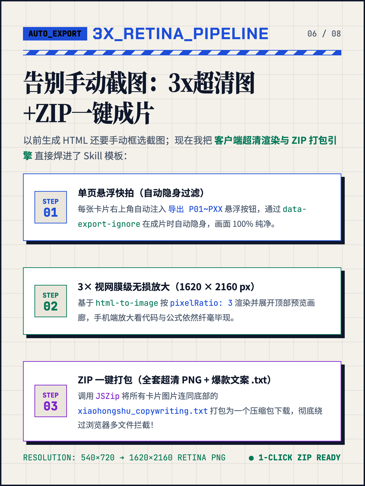
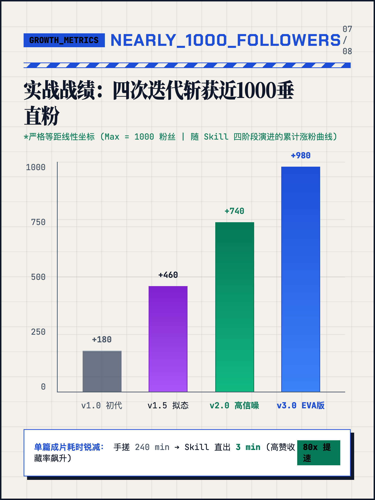
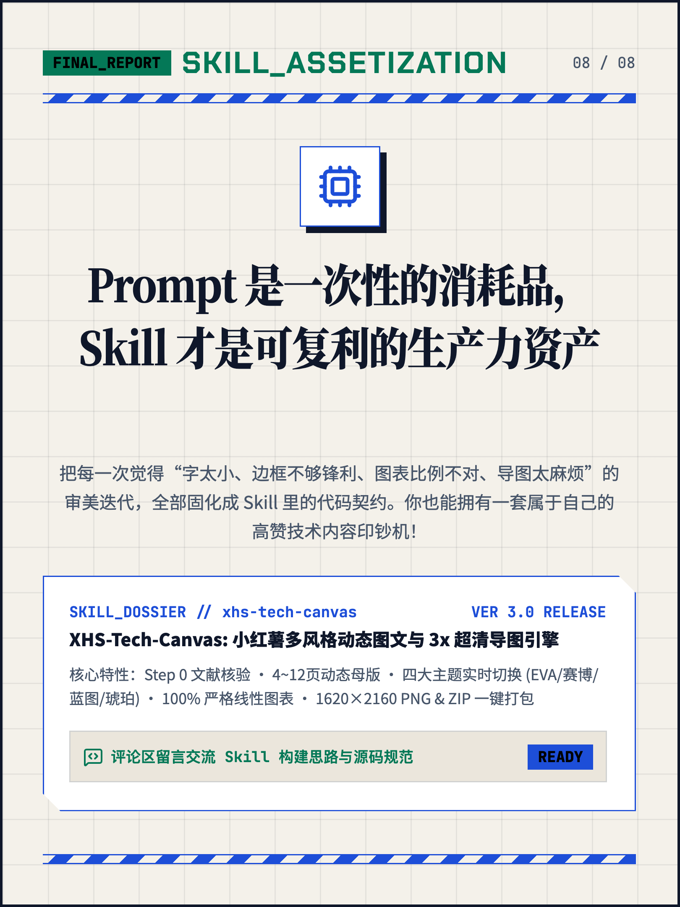

# xhs-skills

我自己打磨的 Claude Code / Agent Skills 合集。目前主要是**小红书技术博文制作**相关的 skill，之后会陆续加入其他的。

## Skills

| Skill | 说明 | 示例 |
| --- | --- | --- |
| [`xhs-tech-canvas`](skills/xhs-tech-canvas/SKILL.md) | 把论文 / 技术博客 / 系统架构拆解成 4–12 张 540×720 小红书卡片（10 种模块化母版、4 套可实时切换主题），一键导出 1620×2160 PNG + 文案 ZIP | [1000 粉复盘 · 瑞士蓝图](examples/xhs-tech-canvas/1000fans-swiss-blueprint/) |

## 安装

把需要的 skill 目录复制（或软链）到 Claude Code 的 skills 目录即可：

```bash
git clone https://github.com/qhy991/xhs-skills.git
cp -r xhs-skills/skills/xhs-tech-canvas ~/.claude/skills/
```

然后在 Claude Code 里直接说「帮我把这篇论文做成小红书图文」，或输入 `/xhs-tech-canvas`。

## 目录结构

```
skills/<skill-name>/      # 每个 skill 一个目录，可直接安装
  SKILL.md                # 入口：触发条件 + 工作流
  references/             # 详细规范，按需加载
  assets/                 # 模板等资源
examples/<skill-name>/    # 用该 skill 生成的真实作品（不随 skill 安装）
```

## 示例：xhs-tech-canvas · 瑞士蓝图主题

这组 8 张图本身就是用 `xhs-tech-canvas` 生成的（文案见 [xiaohongshu_copywriting.txt](examples/xhs-tech-canvas/1000fans-swiss-blueprint/xiaohongshu_copywriting.txt)）。

<table>
  <tr>
    <td></td>
    <td></td>
    <td></td>
    <td></td>
  </tr>
  <tr>
    <td></td>
    <td></td>
    <td></td>
    <td></td>
  </tr>
</table>
